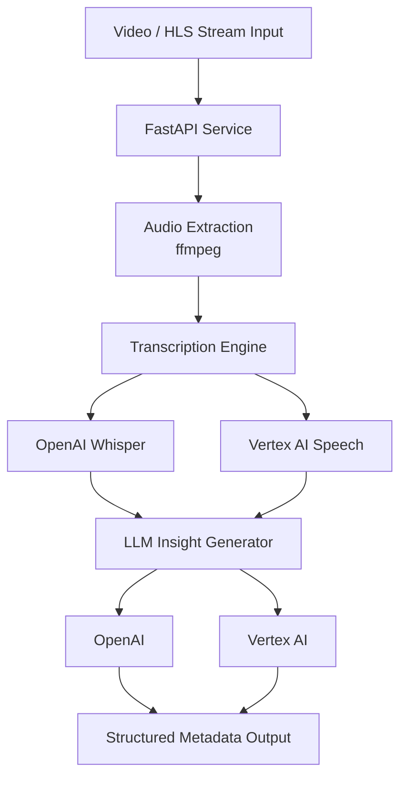

# StreamInsight — AI Video Intelligence Microservice

StreamInsight is an AI-powered video intelligence microservice designed to modernize traditional streaming workflows by automatically generating structured metadata from video content.

The service ingests video streams or HLS playlists, extracts audio, performs speech transcription, and generates structured AI insights such as summaries, chapters, keywords, and learning objectives.

This project demonstrates how modern AI services can enhance media platforms by transforming raw video streams into searchable, structured knowledge.

---

# Overview

Traditional streaming platforms focus primarily on **video delivery**. StreamInsight demonstrates how AI can extend those systems by automatically producing **semantic metadata** that improves discoverability, search, and learning outcomes.

The system performs the following pipeline:

1. Ingest video stream or HLS playlist
2. Extract audio using ffmpeg
3. Transcribe speech using AI models
4. Generate structured insights using LLMs
5. Return enriched metadata via API

---

# Key Features

## AI-Powered Transcription

Supports multiple transcription engines:

* OpenAI Whisper
* Google Vertex AI Speech

This dual-engine design demonstrates how modern systems can leverage multiple AI providers for flexibility and accuracy.

---

## Structured AI Metadata Generation

After transcription, StreamInsight generates structured metadata using schema-enforced LLM responses.

Supports multiple LLMs:

* OpenAI
* Google Vertex AI

Generated insights include:

* video summary
* chapter segmentation
* key topics
* keywords
* learning objectives

This transforms raw video into **machine-readable knowledge**.

---

## Streaming Media Processing

StreamInsight can process:

* video files
* HLS streaming playlists

Audio extraction is performed using **ffmpeg**, enabling support for a wide variety of media formats.

---

## Asynchronous Processing Pipeline

The service uses asynchronous processing to efficiently handle long-running tasks such as:

* media ingestion
* audio extraction
* transcription
* AI analysis

This architecture allows the service to scale effectively under concurrent workloads.

---

## Containerized Microservice Deployment

The application is fully containerized using Docker, allowing it to be deployed easily in cloud or microservice environments.

Typical deployment targets include:

* container orchestration platforms
* streaming infrastructure pipelines
* AI processing backends

---

# System Architecture

The architecture demonstrates a modern AI-enhanced media processing pipeline built around a scalable API layer.

---

# Example Workflow

1. Submit a video or stream URL to the API
2. The service extracts audio from the media stream
3. Audio is transcribed using the selected AI engine
4. AI models generate structured metadata
5. Results are returned as JSON

Example output may include:

* transcript
* summary
* chapter markers
* topic keywords
* learning objectives

---

# Technologies Used

Core technologies powering StreamInsight:

* Python
* FastAPI
* Async IO
* ffmpeg
* Docker
* OpenAI APIs
* Google Vertex AI

These tools combine to create a modern AI-enabled streaming intelligence service.

---

# Example Use Cases

StreamInsight demonstrates applications such as:

* AI-enhanced streaming platforms
* automated lecture indexing
* video search and discovery
* content summarization
* AI-powered educational platforms

---

# Project Goals

This project demonstrates how legacy media streaming architectures can be enhanced using modern AI systems.

Key design goals include:

* modular AI integration
* scalable asynchronous architecture
* containerized deployment
* structured AI metadata generation

---

# Author

Gordon Pusnik

---

# License

© 2026 Gordon Pusnik. All rights reserved.
